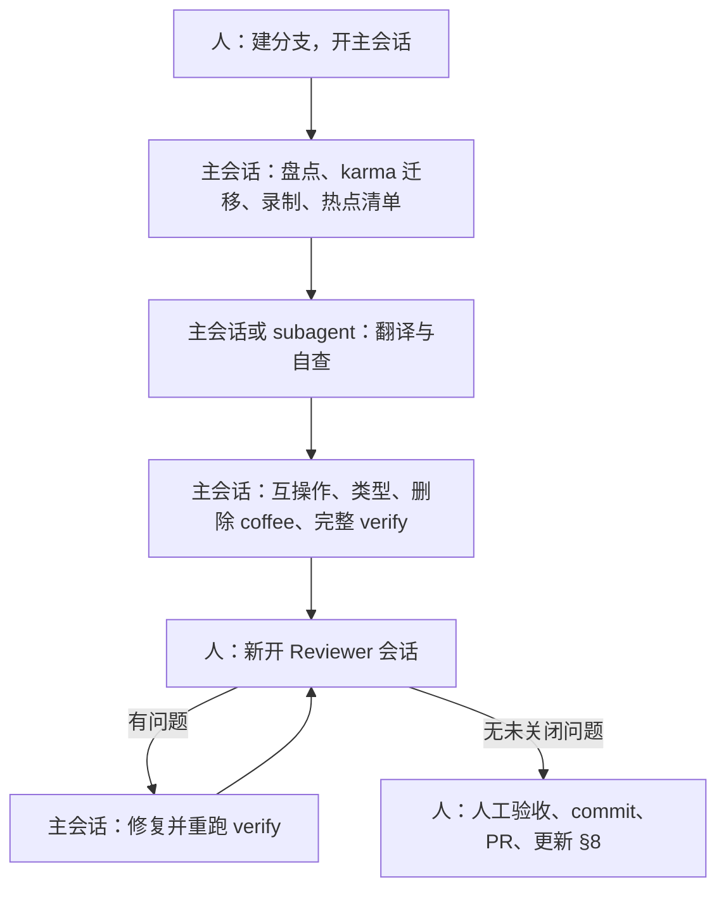

# PLAN.md — 剩余 CoffeeScript 全量迁移到 JavaScript

> 读者：执行迁移的大模型 Agent（以及审阅它们的人）。
> 前置阅读：`AGENTS.md`（sr-dev 用法、构建接线、团队约定）。本文不重复其中内容，只引用。
> 基线：`origin/staging` @ `6103b96a7f`（2026-10）。每批开始前都要重新跑盘点脚本，数据以脚本输出为准。

---

## ★ 工具独立 repo 化（2026-10-21，优先于下文）

B00 产出的护栏工具、快照测试、数据，以及 `PLAN.md`、`EXAMPLES.md`、`progress/`，已从 springboard-retail 移到独立 repo **`/Users/zack/workspaces/retail/retail-coffee-migration`**（下称“工具 repo”）。springboard-retail 里**不提交任何工具代码**，工具也不参与 springboard-retail 的 CI。用法、配置和容器挂载机制见工具 repo 的 `README.md`。

**路径约定**：下文以 `tools/`、`jest/`、`data/`、`.work/` 开头的路径都相对工具 repo 根目录；`src/…`、`webpack.config.js`、`shims.d.ts` 等相对目标 app 目录（`<targetRepo>/apps/monolith`）。目标 checkout 由 `config.json` / `config.local.json` / `COFFEE_TARGET_REPO` 指定。

| 原位置（springboard-retail） | 现位置（工具 repo） |
| --- | --- |
| `apps/monolith/migration/coffee/` 下的 `.mjs`/`.sh`/`.cjs`、`lib/`、`selftest/` | `tools/` |
| `migration/coffee/{batches.json,coffee_manifest.txt,interop_allowlist.json,public_globals.json,sagamore_registry.json}` | `data/springboard-retail/` |
| `migration/coffee/baseline/`、`migration/coffee/shapes/` | `data/springboard-retail/baseline/`、`data/springboard-retail/shapes/` |
| `migration/coffee/.work/`（含 `hotspots/<Bxx>.md`、`verify/`、`inventory.json`） | `.work/`（gitignore） |
| `migration/coffee/.work/coffee-tools`（宿主机依赖） | `.host-deps/`（gitignore） |
| `migration/coffee/EXAMPLES.md` | `EXAMPLES.md` |
| `src/__tests__/coffee_migration/*.test.js` | `jest/tests/` |
| `src/jest_helpers/coffee_migration/*.js` | `jest/helpers/`（新增 `tool_paths.js`） |
| 仓库根 `PLAN.md`、`progress/` | 工具 repo 根 `PLAN.md`、`progress/`（目标 worktree 的 `AGENTS.md` 保留并指向这里） |

**变更的规则（与下文冲突时以本节为准）**：

1. **命令**：在工具 repo 里运行，如 `tools/verify.sh [--quick] [--batch Bxx]`、`node tools/inventory.mjs --batch Bxx`、`tools/record_shapes.sh Bxx`、`tools/sr_web.sh <cmd…>`。脚本自己切到目标 app 目录；`src/…` 形式的参数从任何目录都能用。
2. **容器**：`tools/sr_web.sh` 把工具 repo 挂到容器内 `/sr/apps/monolith/coffee-tools`（在 Yarn workspace 目录内，PnP 能解析目标的依赖；`jest ./src`、`eslint src`、tsc 都扫不到它），工作目录 `/sr/apps/monolith`。docker 会在宿主机创建空目录 `apps/monolith/coffee-tools/`，`tools/setup_host.sh` 把它写进目标仓库的 `info/exclude`。
3. **G4/G5 只在本地跑**（`verify.sh` 第 4 步的 guardrail jest），不再进 CI。形态快照 `data/…/shapes/*.json` 和注册表快照 `data/…/sagamore_registry.json` **提交在工具 repo**，不进目标 PR。下文“快照和转换放在同一个 PR”“注册表变化必须出现在 PR diff”改为：快照在工具 repo 提交；注册表变化在目标 PR 描述和进度文件里说明。
4. **0b 快照完整性**改为按内容校验：本分支每个转换掉的 `.coffee` 模块都要有 `shapes/<key>.json`，其 `recordedFrom` 以 `.coffee` 结尾，`recordedSha`（录制时写入的 git blob sha）等于该 `.coffee` 在 merge-base 上的 blob；`sagamore_registry.json` 在工具 repo 里有未提交修改时需 `ALLOW_REGISTRY_CHANGE=1`。
5. **新增 0c tool-leaks**：目标分支不得包含 `apps/monolith/coffee-tools/` 或 `apps/monolith/migration/coffee/` 下的文件，改动的文件不得引用 `coffee-tools/`、`jest_helpers/coffee_migration`、`__tests__/coffee_migration`、`retail-coffee-migration`。
6. **G9 helpers 仅本地可用**：提交到 springboard-retail 的测试必须自包含——不能 import `jest/helpers/*`，也不能加载整个 app（`loadLegacyApp`）。批次的提交测试确实需要某个 helper 时，在该批 PR 里把函数复制到 `src/jest_helpers/` 作为普通代码。
7. **基线**：`data/…/baseline/` 提交在工具 repo。搬迁后必须重录一次（旧基线的 `jest-passing.txt` 含 3 个已移走的 `src/__tests__/coffee_migration/*` 套件）。
8. **B00 不再单独给 springboard-retail 提 PR**（原“Add CoffeeScript migration guardrails”）；护栏随工具 repo 提交。
9. **多个 worktree**：每个目标 worktree 用自己的 `config.local.json`（或 `COFFEE_TARGET_REPO` + `COFFEE_WORK_DIR`）和不同的 `container.projectName`，避免共用 `.work/` 与 compose 项目。

---

## 0. 结论速览

| 问题 | 结论 |
| --- | --- |
| 一次性转完还是分批？ | **分批**。先做 1 个护栏批次（B00），再做约 32 个转换批次（B01–B32）。每批约 1,000–1,800 行 coffee，或约 15 个文件，按功能目录划分，每批一个 PR。 |
| 为什么不一次性转完？ | 322 个文件、31k 行，对应 JS 产出约 35k 行。任何模型都无法在单一上下文里逐行对照原文审阅，人也审不了这么大的 diff。团队约定是小 PR（参见 `c348c2712d` 等提交）。长期 worktree 期间 staging 会持续变动，大 PR 的冲突成本过高。按批次拆分后，出问题可以单独 revert。 |
| 能否并行？ | 可以，但有条件。同一批内可以按**不相交的文件集**派生多个子 Agent 并行转换，由编排 Agent 统一跑校验、统一修改共享文件。不同批次**串行合并**，因为它们共享快照 JSON、`shims.d.ts`、`webpack.config.js`。具体规则见 §10.4。 |
| 怎么开始执行？ | 按 §10 开会话：每批一个主会话，用 `progress/progress.<bxx>.md` 记录工作进度，可以按规则派 subagent，Reviewer 由人另开独立会话。提示词见 §10.5。 |
| 主力模型 | 见下表。 |

### 模型与思考档位

| 角色 / 工作类型 | 推荐模型 | 思考档位 | 理由 |
| --- | --- | --- | --- |
| B00 护栏基础设施（脚本、快照测试、verify） | **Claude Opus 5.5** | **高** | 需要理解 webpack/jest/karma/TS 互操作，写出的工具决定后面所有批次的可信度。 |
| Backbone App、设备/打印/支付、`pos.coffee` 拆分、核心基类、入口文件（B15、B16–B31） | **Claude Opus 5.5** | **高** | CS1 class / `super` / 胖箭头 / 原型数据属性 / `this===window` 等语义陷阱密集，且大多数文件**没有测试**。 |
| 每批完成后的独立审阅（Reviewer） | **Claude Opus 5.5** | **高** | 用全新上下文逐文件对照 `.coffee` 原文与最终 JS，专门找语义漂移。审阅者不能和执行者是同一个会话。 |
| `createReactClass` 组件批次（B02–B14 中标注的批次） | **Claude Sonnet 5.5** | **中**；标注“高”的批次用**高** | 模式高度重复：DOM 工厂改写成 JSX，`createReactClass` 改写成 class。第一个组件批次 B04 产出范例后，其余批次按范例直接翻译，Sonnet 的性价比最好。 |
| 编排 Agent（拆分子任务、跑 verify、汇总） | Opus 5.5 | 中 | 需要判断失败原因并分派修复。 |
| 机械性工作：跑 verify 并汇总日志、更新进度表、残留扫描 | Claude Haiku 5.5 | 低 | 不做语义判断。**禁止**用 Haiku 写转换代码。 |

> 未评估非 Claude 模型，本计划不对它们做能力判断。如需替换，请先在 B02（小、有测试）上试跑，并通过 Reviewer 审阅。

---

## 1. 现状要点（决定计划形状的事实）

详细数据见 `apps/monolith/tmp/coffee_inventory.json`（由盘点脚本生成，B00 会把脚本正式化）。

- 322 个 `.coffee` 文件、31,227 行，全部在 `apps/monolith/src`。
- **全局注册**：209 个文件给 `Sagamore.*` 赋值，其中 80 个的全局在别处被静态引用；134 个文件读取 `Sagamore.*`。**静态分析只能给出下限**，因为存在以下用法：
  - 动态注册表查找：
    - `Sagamore.Components.Layouts[layoutName]`（`components/app.js`）
    - `Sagamore.Components[metadata.component]`（`components/lookups/items.js`）
    - `Imports.Errors.Resolvers.Lookups[type]`（`imports/errors/resolvers/key.coffee`）
    - `Imports.Errors.Details[type]`（`imports/error.coffee`）
  - 命名空间别名，如 `Mixins = Sagamore.Components.Mixins`。
  - `apps.coffee` 中约 43 条 `appClass: Sagamore.Apps.X`。
  - `.jst.eco` 模板中约 100 处 `Sagamore.Formats.*`。
  - `main.coffee` 的 `require.context` 批量加载。
- **公开 API**：`Sagamore.API.V1`、`Sagamore.App`、`Sagamore.View` 写在 `api/doc/custom_apps.md` 中，是给自定义 App 用的接口。**这些全局永久保留**。（B00 核实：`Sagamore.View` 在 staging 上已经缺失，见 §9 Q6。）
- **语法模式分布**：

  | 模式 | 文件数 |
  | --- | --- |
  | DOM 工厂 | 235 |
  | `createReactClass` | 180 |
  | 存在运算符 `?` | 117 |
  | coffee `class` | 82 |
  | 胖箭头方法 | 71 |
  | jQuery | 56 |
  | Backbone `.extend` | 35 |
  | `super` | 28 |
  | `arguments` | 8 |

- **测试覆盖**：约 144 个文件（约 17.4k 行）被 jest 或 karma 直接 import。按 jest 覆盖来算，有 88 个只被 jest 覆盖，7 个同时被 jest 和 karma 覆盖，49 个只被 karma 覆盖。**以下大文件没有测试**：
  - `apps.coffee` 881
  - `apps/purchasing/receipts` 834
  - `apps/payment_types` 510
  - `apps/purchasing/returns` 477
  - `apps/financial` 441
  - `apps/integrations/quickbooks` 412
  - `apps/physical_counts` 331
  - `components/purchasing/list_page` 331
  - `apps/settings` 303
  - `apps/invoices` 247
  - `apps/setup_checklist` 239
  - `layouts/getting_started_with_tips` 246
  - `apps/receipts` 204
- **扇入最高的模块**：
  - `initial_state`（147，主要来自测试）
  - `app.coffee`（53 个 importer，其中 33 个是 coffee；它是所有 App 的基类）
  - `components/switch` 27
  - `apps/collection` 23
  - `breadcrumbs` 23
  - `backbone_view` 22
  - `tab` 20
  - `lib/util` 19
- **导出与互操作**：
  - 297 个文件用 `module.exports = X`。
  - coffee 调用方有 238 处裸 `require`（没有 `.default`）。
  - JS 文件对 CJS 模块有 164 处具名 import，例如 `import { setWindowLocation } from 'sr/lib/util'`。
  - 全仓库有 490 处 `import * as X from 'sr/…'`。

  一个模块从 CJS 改成 ESM `export default` 后，这三类调用方都可能**静默拿到错误的值**，因为 webpack 的互操作不会报错。这是本次迁移**最大的一类自动化风险**，B00 专门为它建护栏。
- **构建接线**：
  - `webpack.config.js` 的 alias `main$`、`sagamore$`、`sync$`、`jst$` 硬编码指向 `.coffee`。
  - `imports-loader?wrapper=window` 只作用于入口 `.coffee`。`main.coffee` 中 `@sagamore = new Environment()` 依赖 `this === window`。
  - `resolve.extensions` 中 `.js` 排在 `.coffee` 前面，**同名 `.js` 会覆盖 `.coffee`**。
  - 非 karma 构建开启了 `CircularDependencyPlugin`（`failOnError`）。
- **TS**：
  - `shims.d.ts` 中有 `declare module 'sr/lib/util'` 等 coffee 模块的环境声明。环境声明的优先级高于真实文件，所以**转成 JS 后 shim 会继续遮蔽真实类型**，需要清理。
  - 另有 17 个 coffee 模块被 TS 文件 import。
- **现有工具**：`yarn convert:coffee`，依次执行 decaffeinate → deglob（硬编码 `DEGLOB = true`，会改写整个代码库）→ codemod 01–07 → prettier。**本计划不使用这个工具**，理由见 §2 第 2 条。仓库依赖里已有 `coffeescript` 1.12.7 编译器，计划只用它查看编译结果和 AST，见 G1 和 G7b。
- **CI 必过项**：apps lint、jest、karma。改动 apps 的 PR 还会跑 e2e（Playwright）。
- **karma 已经废弃**（`src/DEPRECATED_spec`，用 jasmine，入口是 `karma-entry.js`）：
  - 规模：743 个 spec 加 17 个辅助文件，共约 7.1 万行。大部分测的是已经是 JS 的 reducers、sagas、stores 和组件。
  - 和 coffee 相关的部分：
    - 104 个 spec 直接 import 了 coffee 模块，共涉及 56 个模块，其中 49 个 spec 只引用了 `initial_state.coffee`；
    - 17 个 spec 读取或 mock 了 `Sagamore.*` / `sagamore.*` 全局；
    - 有 49 个 coffee 文件（约 3.7k 行）**只有 karma 覆盖**，比如 `print_manager`、`imports/errors/details/default`、`pos/completed_ticket_options`、`pos/notices`、magento 映射组件、`pager`。
  - **团队策略：不新增任何 karma 用例；凡是需要改动的 karma 用例，一律迁移成 jest 测试后从 karma 中删除。** 参见 `974499e62f`、`63c46ac942`、`b3f8f61f6c`、`edc495731c`。具体规则见 §4.1。
  - karma 会通过 `require('./src/main')` 加载整个应用，所以在它整体下线之前，它仍然是“所有模块都能加载”的回归检查，每批都要跑。
  - karma 整体下线**不在本计划范围内**，留给团队单独决定。

---

## 2. 总体策略

1. **先建护栏再转换**（B00）。护栏全部基于**转换前的 coffee 行为录制快照**，转换后做对比。快照文件随 PR 提交，CI 会自动跑。
2. **由 LLM 直接从 `.coffee` 源码翻译成目标写法，不使用 decaffeinate、`yarn convert:coffee` 或 jscodeshift codemod。**
   - **为什么不用工具**：工具的产出会带来 `__guard__` 之类的 helper、多余的 `return`、`/* eslint-disable */` 和 decaffeinate suggestions，还要再做一轮清理。团队以前评估过，这类写法会增加转换和审阅的负担。
   - **语义基准是 `.coffee` 源码本身**。执行者按 §6 的规则逐段翻译，一次写成团队风格的 ES module、JSX 或 `.extend` 写法。
   - **保持顶层结构和方法顺序与源码一致**，不顺手重排、拆分或合并，方便 Reviewer 把 coffee 和 JS 并排逐段对照。
   - **语义有疑问时参考 CoffeeScript 1.12.7 编译器的真实输出**（G1 的 `coffee_compile.mjs`），也就是线上实际运行的代码。它只用来确认语义，比如隐式 return 返回了什么、`?` 编译成了什么、胖箭头在哪里绑定，**不作为翻译起点，也不提交**。
   - **代价**：直接翻译比机械翻译更容易出现语义偏差。这部分风险由以下几道护栏来兜：
     - 转换前录制的快照（G4、G5）；
     - 先在 coffee 版本上跑通的测试（G9 和 §4.1）；
     - 从 coffee AST 自动列出的语义热点清单（G7b）；
     - 独立 Reviewer 的逐段对照。
3. **默认不去全局**。转换批次保留 `Sagamore.X = X` 注册（加 `// eslint-disable-next-line no-restricted-globals -- TODO(coffee-deglob)`），只把**本文件内部**对 `Sagamore.*` 的读取改成 import，而且仅在不会形成循环依赖时这样做。全局清理放到 B32 之后的可选阶段 P9。这样每批的影响范围只限于本批文件。

4. **调用方互操作必须显式处理**。被转换模块如果还有 coffee 或 CJS 调用方，要么改成具名导出，要么给调用方加 `.default`。由互操作检查器（B00）强制执行，不靠人记。
5. **Backbone 继承体系永远不改成 ES `class`**。统一使用 `Parent.extend({...})`，原因见 §6.2。React 组件可以改成 `class extends React.Component`；带 mixins 的保留 `createReactClass`。
6. **karma 只减不增**。本批需要改动的 karma 用例（判定标准见 §4.1），要在**转换之前**迁移成 jest，并且先基于 coffee 版本跑通，然后才从 karma 中删除。这样迁过来的 jest 用例也就成了本批的护栏。不得修补 karma 用例，也不得新增 karma 用例。
7. **顺序**：
   - 先做小而有测试的叶子，验证流水线。
   - 然后按功能目录推进 components，再做设备/打印层、Backbone apps，接着拆分 `pos.coffee`，然后是核心基类（`app`、`collection`、`environment`、`initial_state`），最后是入口文件和清理。
   - 基类放在后面，是因为它们有大量 coffee 子类。等子类都转成 JS 的 `.extend` 写法后，基类改写才安全。

---

## 3. B00：护栏基础设施（Opus 5.5，高；不转换任何 coffee）

所有迁移工具放在独立的工具 repo（见文首“★ 工具独立 repo 化”）。容器里通过 `tools/sr_web.sh` 挂在 `apps/monolith/coffee-tools`，`eslint src` 和 `jest ./src` 都扫不到。快照测试放在工具 repo 的 `jest/tests/`，只在本地由 `verify.sh` 跑，不进 CI。

> 运行环境：除盘点和静态检查脚本可以在宿主机用 Node 跑之外，其他命令都在 `sr_web` 容器里执行（需要 `unsandboxed`）。容器里**没有可用的 git**，因为 `.git` 指针指向的主仓库没有挂载进去。需要变更文件列表的步骤，先在宿主机算好，再作为参数传进去。

### B00 实现要点（以此为准；下文 G1–G9 是原始设计）

- **容器入口用 `tools/sr_web.sh <cmd…>`**，不要用 `sr-dev run`：后者透传参数不加引号，`sh -c '…'` 会被拆散。`sr_web.sh` 默认 `COMPOSE_PROJECT_NAME=sr-coffee`，并把 corepack 与 jest 缓存放在挂载目录里（`--rm` 容器否则每次冷启动：jest 加载 main 100 秒 vs 3 秒）。宿主机工具依赖用 `tools/setup_host.sh` 装一次。
- **工作目录是 `.work/`（gitignore），不是 `apps/monolith/tmp/`**：production webpack 先输出到 `tmp/`，`CleanBuildPlugin` 再把整个 `tmp/` 移成 `public/`，放在 `tmp/` 里的东西会被一次 `yarn build:production` 带走。热点清单因此在 `.work/hotspots/<Bxx>.md`（下文所有 `tmp/coffee_hotspots/` 都指这里）。
- **G2**：`batches.json` 的 glob 相对 `src/`、**不带扩展名**，与 `coffee_manifest.txt`（迁移开始时的 322 个 coffee 模块）取交集，转换后仍能定位。`inventory.json` 是生成文件，不提交。`--batch Bxx [--json|--list files|coffee|js|callers|karma|related]`、`--summary`、`--check`、`--freeze`。
- **G4**：没有用 `jest.isolateModules`。模块依赖完整的全局注册表，隔离加载会大量失败且把依赖的注册算进来。实际做法：用带追踪的 `global.Sagamore`（Proxy，写入时取调用栈里第一个 `src/` 文件）加载一次 vendor+main，再逐模块 require 取形态；每个模块的“全局注册副作用”= 由该文件执行的写入（路径 + 类型 + 值的身份）。原型上**所有**数据属性都记录；`model`/`collection`/`appClass` 记为导出它的模块 `module:<key>`。录制时加载失败的模块不再跳过，而是判失败。录制用 `record_shapes.sh <Bxx|files…>`。快照在 `data/springboard-retail/shapes/`。B00 不录任何模块（各批自录）。
- **G5**：jest 方案（见 §9 Q1）。遍历规则：普通对象全部向下，函数只沿大写开头的静态属性向下（`Sagamore.Apps.Integrations.Clover` 这类挂在 App 类上的注册），深度 ≤ 8，共 481 条路径。另记 `Apps.*` 路由、Layouts、Imports.Errors、Formats、`appOptions`。`public_globals.json` 里的名字必须存在。
- **G6**：采集器 `collect.mjs`（容器内）、比较器 `compare.mjs`（宿主机）、`baseline.sh`。除 PLAN 列的文件外还记录：`jest-passing.txt`（每文件通过数，防止删/skip 测试）、`karma-specs.txt`（`DEPRECATED_spec` 下每个文件的 it 数与 sha）、`test-config.txt`（karma-entry/karma.conf/jest.config 等指纹）。webpack 通过 `webpack_stats.cjs` 用 Node API 取 stats（配置里 production 的 SILENT stats 会丢模块列表）。
- **G7**：扫描在 `lint_scan.mjs`（TS AST）。任何 `class … extends X`（X 不是 React.Component/PureComponent/Error）都判失败，含别名/括号/匿名类；另加 coffee 1.12.7 编译产物指纹（`__super__`、`hasProp.call`、`superClass`、`refN`、`_this`…）；整文件 `eslint-disable` 与 `/* eslint rule: 0 */` 一律失败，行级 disable 要求 `-- <≥10 字符理由>` 或 `TODO(coffee-deglob)`。
- **G8**：`verify.sh [--quick] [--batch Bxx] [--base origin/staging]`，宿主机用 `changes.mjs` 算文件集（merge-base + 未跟踪文件），容器部分一次性跑 `verify_container.sh`。新增步骤 0（`inventory --check`）和 0b（快照完整性：`shapes/*.json` 必须录自 merge-base 上仍是 `.coffee` 的模块、`recordedFrom` 必须是 `.coffee`、本分支转换的每个模块都要有快照、`sagamore_registry.json` 的修改须 `ALLOW_REGISTRY_CHANGE=1`）。G7 也覆盖本分支新增的非测试代码文件（拆分/移动后的文件）。webpack 模块集合只放行“本分支新增文件”的新增和“删除且无替代”的删除；karma spec 缩小必须是纯删除（当前文件是 staging 版本的行子序列）；karma 通过数的下降不得超过删除的 it 数。完整模式约 3.5–4 分钟，`--quick` 约 25 秒。
- **G9**：`jest/helpers/legacy.js`（`mockAjax`、`renderBackboneApp`、`mountLegacy`），需要完整全局环境时在 `beforeAll` 里调 `legacy_app.js` 的 `loadLegacyApp()`。
- 自测脚本：`tools/selftest/interop.mjs`（G3）、`selftest/hotspots_check.sh`（G7b `--check`）。
- 已知局限：`jest.mock` factory 形状不匹配只报 warning（靠相关 jest 测试兽底）；G4 只看导出值，未导出的内部类靠 G7 与人工 Reviewer；React class 的方法绑定仍需 Reviewer 逐个核对；`sagamore`/`JST`/`Highcharts` 等非 `Sagamore` 的 window 全局尚未快照（B30/B31 前补）。

### G1. 目标写法范例与语义参考工具（不使用转换工具）

- **`EXAMPLES.md`**：列出每类代码要对齐的团队现有写法，作为执行 Agent 的必读材料。
  - **Backbone**：
    - `view.js`、`model.js`、`collection.js`
    - `views/dialog.js`、`apps/roles.js`
    - `models/sales/order.js`（`974499e62f`）
    - `models/import/*.js`（`63c46ac942`）
  - **普通模块和视图**：
    - `views/export_button.js`（`c348c2712d`）
    - `views/sales/*.js`（`93386079e0`）
    - `views/action_line.js`、`views/actions.js`（`b3f8f61f6c`）
  - **带 mixins、保留 `createReactClass` 的组件**：`components/backbone_lookup.js`。
  - **React class 组件**：B04 合并后，从它的产出里挑 2–3 个补进来，作为后续组件批次的范例。
  - 每个范例写一两句说明它体现了哪条约定，例如具名导出、`.extend` 加 bind、`import { x } from 'underscore'`。
- **`tools/coffee_compile.mjs <file.coffee> [--range a:b]`**：用仓库已有的 `coffeescript` 1.12.7 执行 `compile(src, { bare: true })`，把结果输出到 stdout，可以只输出指定行范围对应的片段。只用来在语义有疑问时核对，**不落盘，也不提交**。
- **互操作修复由 Agent 按 G3 的报错手工完成**，不使用 `deglob` 或 `addDefaultToRequires`。前者会改写整个代码库，后者是批量改写，都不适合按批次精确控制。

### G2. 盘点与进度：`tools/inventory.mjs`

- 把 `tmp/coffee_inventory.mjs` 和 `tmp/coffee_exports.mjs` 正式化，合并到这个脚本。
- 默认模式（宿主机 Node 可运行），输出 `.work/inventory.json`，每个文件包含：
  - 行数
  - importer（区分 coffee、JS、TS、测试）
  - 全局赋值，以及这些全局的静态使用者
  - 已知的动态注册表命中
  - 导出形态
  - 语法模式
  - 关联测试
- `--batch Bxx`：读取 `data/springboard-retail/batches.json`（批次 → glob 列表），打印该批的文件、外部调用方、需要处理互操作的位置，以及按 §4.1 (a)(b) 判定需要迁移的 karma spec（列出文件路径、行数，以及命中的 `describe` 名称）。
- `--summary`：输出剩余文件数和行数、每个批次的状态，以及剩余 karma spec 的数量，用于更新 §8 的进度表。

### G3. 互操作检查器：`tools/check_interop.mjs`（静态，宿主机运行）

解析 `src/**/*.{js,jsx,ts,tsx,coffee}` 的 import 和 require。用和 webpack 相同的规则（`sr/` alias、扩展名顺序）解析目标模块，再判断目标的导出形态：

- `esm-default`
- `esm-named`
- `cjs-value`
- `cjs-object`
- `coffee`

以下情况**报错**：

| 调用方写法 | 目标形态 | 问题 |
| --- | --- | --- |
| `require('x')` 后直接使用，没有 `.default` 也没有解构 | `esm-default` | 拿到的是命名空间对象 |
| `import * as X from 'x'`，并且把 `X` 当函数/类调用，或者访问了 `X.<非导出名>` | ESM | 命名空间对象不可调用 |
| `import { a } from 'x'` | 没有导出 `a` | eslint `import/named` 看不到 coffee 目标 |
| `import X from 'x'` | 只有具名导出 | 拿到 `undefined` |
| TS 文件 import 了已转成 JS 的模块 | `shims.d.ts` 里仍有对应的 `declare module` | 只**警告**，提示清理 shim |

其他规则：
- 同一路径下 `.coffee` 和 `.js` 并存时报错，因为 `.js` 会静默覆盖 `.coffee`。
- 支持 `--files` 参数：只检查与给定文件相关的边（调用方和被调用方），也支持全量检查。

### G4. 导出形态快照（jest）：`jest/tests/export_shapes.test.js`

- 读取 `data/springboard-retail/shapes/*.json`，每个模块对应一个快照。
- `UPDATE_COFFEE_SHAPES=1` 时录制，否则比对。
- **录制必须在转换前、基于 `.coffee` 进行**（`tools/record_shapes.sh Bxx`）。快照提交在工具 repo，不进目标 PR；`recordedSha` 把它和 merge-base 上的 `.coffee` 绑定（verify 0b）。
- 每个模块在 `jest.isolateModules` 中加载。加载前后各对 `global.Sagamore` 做一次深层键路径快照，两者的差集就是本模块的**全局注册副作用**。
- 先对模块值做归一化：`v = m && m.__esModule ? m.default ?? m : m`，同时记录具名导出键。

需要记录的内容：

- `typeof`
- 函数类型：`es-class` 还是 `function`（判断依据是 `Function.prototype.toString` 的结果是否以 `class` 开头）
- `isReactComponent`、`displayName`
- `propTypes`、`contextTypes` 的键
- `defaultProps`（JSON 安全的值）
- 静态自有键（排除 `length`、`name`、`prototype`），以及 `__super__` 是否存在
- 原型链（直到 `Backbone.*`、`React.Component` 或 `Object` 为止）上的方法名集合
- **原型上的数据属性值**，包括 `routes`、`events`、`tagName`、`className`、`defaults`、`idAttribute`、`urlRoot`、`template` 是否存在，以及 `model` 和 `collection` 的标识
- 对象型导出：每个键的类型

比较规则需要预置以下“允许的差异”：

- `createReactClass` → `class`：
  - 允许 `kind` 从 `function` 变为 `es-class`。
  - 允许 `__reactAutoBindPairs`、`getDefaultProps`、`getInitialState` 等 createReactClass 内部键消失，但 `defaultProps` 必须相等。
  - 业务方法集合不能减少。
- **硬规则**：只要录制时存在 `extend` 静态方法或 `__super__`，转换后 `kind` 必须仍是 `function`，不能是 `es-class`。

在 jsdom 里加载失败的模块，记录 `{ loadError: <message> }` 并跳过形态比对，改由 G5 的运行时注册表兜底。比对时如果模块从“能加载”变成“不能加载”，判定失败。

### G5. 运行时注册表快照（jest；不新增 karma 用例）：`jest/tests/sagamore_registry.test.js`

- 优先方案是 jest。在 jsdom 里仿照 `karma-entry.js` 的加载顺序：先 `require('vendor')`，再 `require('main')`；在此之前，`jest_helpers/global.setup.js` 已经准备好了 jQuery、Backbone 和 shim。只 mock 那些在 jsdom 里确实跑不起来的第三方脚本，比如 Highcharts 和插件探测。
- 如果 B00 发现 `main` 无法在 jsdom 里完整加载，就改成一个 CI 不跑的脚本 `tools/registry_snapshot.mjs`：先 `yarn build`（dev），再用 `sr_web` 镜像里 karma 用的那个 Chromium 加载构建产物，读出注册表。这个脚本由 `verify.sh` 调用。**不允许为此在 `DEPRECATED_spec` 里加 spec。**
- 在完整加载 `src/main` 之后，遍历 `window.Sagamore`（深度 ≤ 5），对每个键路径记录类型（`es-class`、`function`、`object`、原始值），然后与 `data/springboard-retail/sagamore_registry.json` 比对。
- 额外记录：每个 `Sagamore.Apps.*` 的 `prototype.routes`、`Sagamore.Components.Layouts` 的键、`Imports.Errors.Details` 和 `Imports.Errors.Resolvers.*` 的键、`Sagamore.Formats` 的键。
- `UPDATE_COFFEE_REGISTRY=1` 时录制。
- 注册表的任何变化都必须重录、提交到工具 repo，并在目标 PR 描述和进度文件中说明原因（未提交时 verify 0b 需 `ALLOW_REGISTRY_CHANGE=1`）。只有 P9（去全局）阶段才会预期它缩小。
- `apps.coffee` 是一个独立的 webpack entry，`main` 不会加载它：
  - 如果 B00 能用 jest 加 mock 加载它，就在 G4 里录下它的路由表：每条路由对应的 `appClass` 路径和 `routes`。
  - 如果做不到，就把录制路由表这一步留到 B31 开始前。

### G6. 基线录制：`tools/baseline.sh`

在 B00 结束时录制一次，之后每次 rebase 到新的 staging 都要重录。小文件提交到 `data/springboard-retail/baseline/`：

- `jest-failures.txt`：`yarn jest ./src --json` 的失败用例集合。预期为空；如果 staging 本身就有失败用例，记下来。
- `karma.txt`：`yarn test:karma` 的结果摘要，包括用例总数和失败用例列表。这份基线只用来对比回归。karma spec 的数量只会随着迁移减少。
- `eslint.json`：`yarn lint:js --format json` 按 规则 × 文件 统计的数量。
- `tsc-errors.txt`：`yarn tsc --noEmit -p tsconfig.json` 的错误集合，归一化为 `文件 (TSxxxx): 消息`，**不含行号**。
- `webpack-modules-{dev,prod}.txt`：两种模式下 `webpack --json` 的 stats，取每个 chunk 的模块路径集合，并把扩展名统一归一化为 `.<ext>`。这个基线用来发现两类问题：
  - `require.context` 漏掉了模块，或者 alias 指错了
  - 意外引入的新依赖
- `yarn build`（production）能成功。

### G7. 严格 lint 与残留扫描：`tools/lint_converted.sh <files…>`

对**本批新增的 JS 文件**执行：

```
eslint --max-warnings 0 --rule 'no-undef: error' --rule 'import/no-unresolved: error' --rule 'no-unused-vars: error'
```

同时用 `rg` 扫描以下内容，命中即失败：

- 机械转换工具的痕迹：`__guard__`、`__guardMethod__`、`__range__`、`__extends`、`__bind`、`__indexOf`、`__slice`、`__hasProp`、`decaffeinate`、`bulk-decaffeinate`，以及文件头的整文件 `/* eslint-disable`。本计划不使用这些工具，一旦命中，说明执行者违规用了工具或照抄了编译输出。
- `React.DOM`、`createFactory`
- `class \w+ extends (Backbone\.|View|App|SRApp|Sagamore\.|.*Collection\b|.*Model\b)`，也就是 Backbone 体系被改成了 ES class
- 新增的 `eslint-disable`，只有带 `-- TODO(coffee-deglob)` 或写明理由的才放行
- `==` 和 `!=`：只允许 `!= null` 和 `== null`

另外**列出**本批新 JS 中所有默认参数和 `&&` 形式的 JSX 条件渲染。这些不判失败，而是作为清单交给 Reviewer 人工确认，原因见 §6。

### G7b. coffee 语义热点清单：`tools/coffee_hotspots.mjs <files.coffee…>`

用 `coffeescript` 1.12.7 的 `nodes()` 解析**转换前的 `.coffee`**，输出一份带 `文件:行` 的热点清单。执行者必须逐项给出结论，Reviewer 逐项复核。这是替代机械转换工具“语义忠实”的主要自动化手段。清单包含以下几类：

- **隐式返回值可能有语义的函数**，包括以下场景：
  - Backbone `events` 哈希里引用的方法；
  - `.on`、`.click`、`.bind`、`$.each`、`.each`、`_.each`、`_.find`、`filter`、`some`、`every` 的回调；
  - `validate`、`parse`、`toJSON`、`url`、`render`、`initialize` 方法；
  - `.then` 的回调。

  对每一个，都给出它最后一个表达式的节点类型。如果最后一个表达式是字面量 `false`、赋值、循环或 `if`，要重点标出。
- **最后一句是循环的函数**：它们会隐式返回数组。
- **默认参数**：对 `null` 和 `undefined` 都会生效。
- **存在运算符**：尤其是 `a.b?()` 和 `a?[x]`。
- **class 相关**：胖箭头方法、裸 `super`、类体中的可执行语句、类体中的数据属性、静态成员。
- **循环相关**：`for own`、不带 `own` 的 `for k of obj`、闭包里捕获了循环变量的循环。
- **其他**：`arguments`、splat、`///` 正则、块字符串、范围切片、模块级的 `@`。
- **React 组件内**：没有 `else` 的 `if` 表达式（用于条件渲染时），以及作为回调传出去的 `@method` 引用（用来核对 class 写法下是否绑定）。

输出位置：`.work/hotspots/<批次>.md`，不提交。执行者在每一项后面填写结论，并把结论贴进 PR 描述。如果项目过多，只贴需要特别处理的那些。

### G8. 每批总校验：`tools/verify.sh`

由编排 Agent 在宿主机调用：先算出本批文件和受影响的调用方，再把它们作为参数传入容器。

| 步骤 | 命令 | 失败条件 |
| --- | --- | --- |
| 1 | `check_interop.mjs --files …`（宿主机） | 任何错误 |
| 2 | `lint_converted.sh <新 js>` | 任何错误 |
| 3 | `yarn eslint <本批所有改动文件>` 与基线对比 | 出现新的错误 |
| 4 | `yarn jest --findRelatedTests <新 js 与改动文件>`，以及工具 repo 的 `jest/tests`（容器内 `coffee-tools/jest/tests`） | 任何失败 |
| 4b | `coffee_hotspots.mjs`（G7b）生成的热点清单里，每一项都在 Agent 自查结果中有结论 | 有遗漏 |
| 5 | `yarn tsc --noEmit` 的错误集合与基线 diff | 出现新的错误 |
| 6 | `yarn build`（dev 和 production），生成 stats 后与基线 diff | 构建失败、出现循环依赖，或者模块集合出现非预期变化（只允许本批文件的扩展名变化，以及新增的测试或辅助模块） |
| 7 | 跑 G5 注册表快照（jest；如果走的是备用方案，就跑 `registry_snapshot.mjs`），以及 `yarn test:karma` | 注册表 diff 不为空；karma 相对基线出现新的失败（修复方式是按 §4.1 迁移到 jest，**不能修补 karma**）；`DEPRECATED_spec` 中出现新增文件或新增用例 |
| 8 | 批次合并前跑 `yarn jest ./src` 全量 | 相对基线出现新的失败 |
| 9 | 可选，相关功能涉及 e2e 时：`JOB_ID=coffee ./misc/dev-tools/bin/sr-dev test e2e <suite>` | 依赖完整栈和端口，见 AGENTS.md 中的坑；也可以交给 CI |

`verify.sh --quick` 只跑 1–4，供 Agent 在迭代中使用。完整模式是批次完成的必要条件。

### G9. 测试脚手架

- 实现在工具 repo 的 `jest/helpers/`（**仅本地**）：
  - `renderBackboneApp`：实例化 App，触发指定路由，并 mock `fetch` 和 `$.ajax`。
  - `mountLegacy`：挂载 createReactClass 或 class 组件，并提供最小 context。
- 提交到目标 repo 的测试不能 import 它们（verify 0c）。需要时把用到的函数复制到目标的 `src/jest_helpers/`，随该批 PR 提交；提交的测试也不能加载整个 app。
- 这些辅助函数用于给**没有测试的大文件**补冒烟测试，也用于§4.1 的 karma → jest 迁移。
- 按需从 `DEPRECATED_spec/helpers` 搬入工厂函数。不要让 jest 用例 import `DEPRECATED_spec` 下的任何文件。
- 决定冒烟测试的覆盖范围时，只看是否有 jest 覆盖。karma 覆盖不算数。有 49 个 coffee 文件只有 karma 覆盖，它们的 karma 用例会按 §4.1 (a) 迁移到 jest。
- 冒烟测试必须**在转换前基于 coffee 写好并通过**，然后原样用于验证 JS 版本。

### B00 验收

- 护栏自身的测试：
  - 故意把一个模块改成错误的导出形态，确认 G3/G4 能报出来。
  - 把一个 Backbone 子类改成 ES `class`，确认 G4/G7 能报出来。
  - 删除一个全局注册，确认 G5 能报出来。
  - 在 `DEPRECATED_spec` 里新增一个用例，确认 G8 第 7 步能报出来。
- 基线全部录制完毕，`verify.sh` 在不做任何改动时全绿。
- ~~以单独的 PR 提交：`HRTL-xxxxx: Add CoffeeScript migration guardrails`。~~ 工具独立后护栏提交在工具 repo，不给 springboard-retail 提 PR。

---

## 4. 每批执行协议（所有转换批次通用）

**执行 Agent** 的步骤：

1. **同步与盘点**：确认分支基于最新的 `origin/staging`（创建分支和 rebase 需要用户授权），然后运行 `inventory.mjs --batch Bxx`。如果本批文件已被其他人修改或删除，先更新 `batches.json`。盘点输出里要列出本批需要迁移的 karma spec，判定标准见 §4.1。
2. **迁移 karma 用例**（在 coffee 状态下完成）：按 §4.1 把需要迁移的 karma 用例改写成 jest，确认它们在 coffee 版本上通过，然后删除对应的 karma 用例。
3. **录制**：在 coffee 状态下完成以下操作：
   - `UPDATE_COFFEE_SHAPES=1` 录制本批模块的形态快照；
   - 按 G9 给没有测试、且超过 150 行的文件补冒烟测试，并确认它们在 coffee 版本上通过；
   - 运行 `coffee_hotspots.mjs <本批 .coffee>`（G7b），生成语义热点清单。
4. **翻译**：逐文件直接从 `.coffee` 写出同名的目标 JS。按 §6 的规则执行，写法对齐 G1 的 `EXAMPLES.md`。
   - 顶层结构和方法顺序保持与源码一致。
   - 每遇到一个热点，就写下结论：是否保留了返回值、默认参数是否需要 `??`、条件渲染用的是三元表达式还是 `&&`。
   - 有疑问时用 `coffee_compile.mjs` 查看编译结果。
   - 超过约 400 行的文件，按顶层单元（class、对象、方法组）分段翻译，每段写完就对照源码自查一次。
   - **禁止**使用 `yarn convert:coffee`、decaffeinate 或 codemod，也禁止把编译输出整体拷贝后再改。
5. **自查**：对照 `.coffee` 原文把每个文件从头到尾再读一遍，重点核对 §6 和热点清单。
6. **调用方**：根据 G3 的报错修复互操作。如果调用方是 karma spec，**不要修补它**，而是按 §4.1 迁移到 jest。
   - 优先改调用方：coffee 调用方加 `.default`，JS 调用方改为默认或具名 import；
   - 其次才是调整被调用方的导出形态。
   - 对象型模块一律改成具名导出（`export const a…` / `export function a…`），**不要**用 `export default { … }`，否则 164 处具名 import 会失效。
7. **类型**：从 `shims.d.ts` 删除已转换模块的 `declare module`。如果暴露出新的 tsc 错误：
   - 能用 JSDoc 或小改动修好的就修；
   - 修不好的就保留 shim，并标注 `// TODO(coffee-js-types)`。
8. **删除 `.coffee`**，跑 `verify.sh --quick` 迭代到全绿，最后跑完整的 `verify.sh`。
   - 如果 karma 出现新的失败，就把失败的用例按 §4.1 迁移到 jest。新写的 jest 用例要先在 coffee 版本上验证一遍：用 `git show origin/staging:<path>.coffee` 临时恢复原文件，跑一次，再删掉。
9. **自查清单**：输出 G7b 热点清单和 G7 列出的人工确认项，并逐条给出结论；同时列出本批迁移了哪些 karma 用例，以及删除了哪些 karma 用例。

**Reviewer Agent**（Opus 5.5，高，全新会话）：

- 输入：本批 diff、`.coffee` 原文（`git show origin/staging:<path>`）、G7b 热点清单和执行者给出的结论、G7 清单、被删除的 karma 用例原文。必要时用 `coffee_compile.mjs` 查看编译结果。
- 职责：只找语义差异，不改风格，并输出“问题 / 已确认无问题”两张表。
- 对 karma → jest 的迁移，还要逐个 `it` 核对：断言是否被弱化、用例是否丢失。
- 执行 Agent 修复后，必须重新跑 `verify.sh`。

**批次完成的定义（DoD）**：

- 本批 `.coffee` 已全部删除；`verify.sh` 完整模式全绿；Reviewer 无未关闭的问题。
- 本批需要迁移的 karma 用例都已迁移到 jest 并从 karma 中删除；`DEPRECATED_spec` 中没有新增或修补的内容。
- §7 中对应的人工验收项已列在 PR 描述里，并标注“需人工”。
- 提交信息为 `HRTL-xxxxx: Migrate <thing> CoffeeScript to JS`，正文写 `Connect to HRTL-xxxxx`。如有行为变化，在提交说明中写明。
- §8 的进度表已更新。

**禁止事项**：

- 不经用户授权就 commit、push 或建分支。
- 在本 worktree 跑 `pristine`、`update`、`down -v`。
- 为了让测试变绿去修改测试的断言语义。只有 mock 的形状（`__esModule`/`default`）可以调整。
- 新增 karma 用例，或者修补 karma 用例（包括改 import、改 mock、改 `.default`）。需要改动的 karma 用例一律按 §4.1 迁移。
- 顺手重构业务逻辑。
- 一个批次修改另一个批次的文件。互操作修复除外，并且必须在 PR 里列出。

### 提示词

执行 Agent、Reviewer、B00 和中断续接的提示词统一放在 §10.5。会话怎么开、进度文件 `progress/progress.<bxx>.md` 怎么写、subagent 怎么用，见 §10。

### 4.1 karma 用例处理规则（团队策略：只迁移，不新增，不修补）

**哪些 karma 用例必须迁移**（`inventory.mjs --batch` 会自动列出前三类）：

- (a) 直接 import 或 require 了本批 coffee 模块的 spec。
- (b) 读取、mock 或 spy 了本批模块注册的 `Sagamore.*` 全局的 spec。
- (c) 测试了本批模块的 spec，即使它没有直接 import，比如通过父组件渲染子组件并断言子组件的 DOM。这类靠盘点脚本加人工判断。
- (d) 本批转换后运行失败的 spec，包括因为导入导出形态变化而失败的。

其他 karma 用例不要动。

**迁移粒度**：

- 只迁移和本批模块相关的 `describe` 或 `it`。如果一个 spec 文件里只有一部分相关，就只移走那一部分，并从原 spec 中删掉，参见 `edc495731c`。
- spec 文件被清空后就删除这个文件。如果有 helper 因此不再被任何 spec 引用，也一并删除。

**放在哪里、用什么风格**：

- 放在被测模块旁边的 `__tests__/<name>.test.js(x)`。如果已经有这个文件，就合并进去。
- 使用 `@testing-library/react`、`@testing-library/user-event`、`@testing-library/jest-dom` 和 `jest.fn`，写法和现有的 `__tests__` 保持一致。
- 不要引入 jasmine 兼容层，也不要用 `test:jasmine` 的配置去跑旧用例。

**等价性要求**：

- 每个被删除的 `it`，都要在 jest 里有一个对应的 `test`，断言强度不能低于原用例。
- 确实不再需要的用例（比如测的是已经删除的代码、或者和已有 jest 用例重复）可以不迁移，但要在 PR 描述里逐条列出并说明理由。
- jest 用例必须**先在 coffee 版本上通过**，再用来验证 JS 版本。
- 按照团队习惯，可以顺手补充断言。

**常见改写对照**：

| karma / jasmine | jest |
| --- | --- |
| `jasmine.createSpy()`、`spyOn(o, 'm')` | `jest.fn()`、`jest.spyOn(o, 'm')` |
| `.and.returnValue(x)`、`.and.callFake(f)`、`.and.callThrough()` | `.mockReturnValue(x)`、`.mockImplementation(f)`、`jest.spyOn` 的默认行为 |
| `spy.calls.mostRecent().args`、`calls.argsFor(i)`、`calls.count()` | `spy.mock.lastCall`、`spy.mock.calls[i]`、`toHaveBeenCalledTimes` |
| `jasmine.any(X)`、`jasmine.objectContaining` | `expect.any(X)`、`expect.objectContaining` |
| `jasmine.clock()` | `jest.useFakeTimers()` |
| `jasmine.Ajax`（`mock-ajax.js`） | mock `$.ajax`，或使用 `src/jest_helpers/fetch.mock.js` |
| jasmine-jquery 的匹配器（`toHaveClass`、`toBeVisible`、`toContainText`） | `@testing-library/jest-dom` 的对应匹配器 |
| `sinon` 的 stub 和 fake server | `jest.fn`、`jest.spyOn`、mock `$.ajax` |
| `global.faker` | 改用显式固定的数据。确实需要时才 `import faker from 'faker'` |
| 依赖 `karma-entry` 已加载的整个应用，以及 `window.Sagamore.*` | 显式 import 被测模块。如果确实需要全局，就在测试里局部设置，并在 `afterEach` 中恢复 |
| `DEPRECATED_spec/helpers/*` 中的工厂和辅助函数 | 只搬需要的部分到 `src/jest_helpers/`，不要 import `DEPRECATED_spec` 下的任何文件 |

**工作量控制**：如果某批需要迁移的 karma 用例超过约 15 个 spec 文件或约 1,500 行，就先拆出一个只迁移测试的先行批次 `Bxx-t`：只把 karma 用例迁到 jest，不转换任何 coffee，单独提交一个 PR。模型用 Sonnet 5.5，中档。已知大概率需要这样拆的是 B29 `initial_state`，它有 49 个 karma spec。先用 G3 确认其中哪些真的会失败；仅用 `import X from` 且导出形态未变的可能不会失败。

---

## 5. 批次清单

- 行数为 coffee 行数。“T” 表示已有测试覆盖。
- **模型**一列中，S 表示 Sonnet 5.5，O 表示 Opus 5.5，括号里是思考档位。
- **所有批次都要经过 Opus（高）的 Reviewer 审阅。**
- 批次的精确 glob 记录在 `data/springboard-retail/batches.json`，由 B00 生成。

### 阶段 1：死代码

| 批次 | 范围 | 规模 | 模型 | 要点 |
| --- | --- | --- | --- | --- |
| B01 | `src/test.coffee`、`src/specs.coffee`（它们引用的 `src/test`、`src/spec` 已不存在）。另外需要核实以下文件：`lib/active_resource`、`lookups/mass_actions/select_items_by_grid`、`components/test_drive/*`、`apps/test_drive` | 约 20–300 | O（高） | 删除前要同时检查以下几处：静态引用、`require.context` 的正则、动态注册表（G5）、模板、`DEPRECATED_spec`、`webpack.config.js` 的 entry/alias，以及 `api/doc`。如果被删除的代码只有 karma 用例在测，就把这些 karma 用例一并删除，不需要迁移，在 PR 里列出即可。**不确定就不删**，转到对应的功能批次。 |

### 阶段 2：先用叶子模块打通流水线

| 批次 | 范围 | 规模 | 模型 | 要点 |
| --- | --- | --- | --- | --- |
| B02 | `lib/*`（14）、`format/*`、`constants/*`、`errors/*` | 约 640 | S（中） | `lib/util` 有 19 个调用方，并且是对象型模块，要改成**具名导出**。`format/*` 被模板中的 `Sagamore.Formats` 使用，全局注册必须保留。 |
| B03 | `models/*`、`reducers/*`、`actions/*`、`api/*`、`global_states/*`、`controllers/imports/*`、`mixins/imports` | 约 660 | S（高） | `api/v1` 是公开 API，必须保留 `Sagamore.API.V1`。models 是 Backbone，见 §6.2。 |

### 阶段 3：components（按功能目录推进；mixins 和通用组件放在最后）

| 批次 | 范围 | 规模 | 模型 | 要点 |
| --- | --- | --- | --- | --- |
| B04 | `components/ecommerces`（10，全部有测试）、`images`、`merge`、`authorization`、`model_helpers`、`roles` | 约 1,400 | S（中） | 第一个组件批次：确定 React class 组件的目标写法，产出补进 `EXAMPLES.md`。建议用 O（高）执行这一批，或者在执行后让人工专门审一遍写法。 |
| B05 | `components/payments`（14） | 约 1,160 | S（高） | 支付流程；`plugin_device_transaction`、`process_credit_card_payment` 没有测试，需要补测试。 |
| B06 | `components/pos`（6，含 `footer` 662）、`components/sales`（`add_payment` 466） | 约 1,590 | O（高） | POS 核心 UI，依赖大量 `sagamore.` 运行时状态。 |
| B07 | `components/item_grids`（15） | 约 1,800 | S（中） | 可以拆给 2 个子 Agent，`edit_page/*`、`images/*` 一组，其余一组。 |
| B08 | `components/imports`：`mapper*`、页面、`menu`、`source(s)`、`options` | 约 1,200 | S（中） | |
| B09 | `components/imports/error`、`errors/**` | 约 500 | S（高） | 涉及动态注册表 `Details[type]` 和 `Resolvers.Lookups[type]`，全局注册**必须保留**，以 G5 为准。 |
| B10 | `components/integrations`（19）、`containers/integrations`（4） | 约 1,690 | S（中） | NuORDER、Mailchimp、ManagementOne。 |
| B11 | `components/inventory`（18） | 约 1,230 | S（中） | `counts/*` 中有一批没有测试的按钮和过滤器，需要补冒烟测试。 |
| B12 | `components/settings`（15）、`branding`、`locations`、`customers`、`test_drive`（B01 判定为非死代码时） | 约 1,500 | S（中） | |
| B13 | `components/items`（8）、`components/lookups`（15） | 约 1,380 | S（高） | lookups 会被 `Sagamore.Components[metadata.component]` 动态查找。 |
| B14 | `components/layouts`（9）、`components/purchasing/list_page` | 约 1,015 | S（高） | `Layouts[layoutName]` 是动态查找；`getting_started_with_tips` 和 `list_page` 都没有测试。 |
| B15 | `components/*.coffee` 根目录下的通用组件（22：`switch`、`tab`、`breadcrumbs`、`backbone_view`、`pager`…）、`components/mixins`（9） | 约 1,510 | O（高） | 扇入高，coffee 调用方较多，互操作修复的工作量最大。mixins 保留对象形态，使用它们的组件保留 `createReactClass`。 |

### 阶段 4：设备、打印与环境周边

| 批次 | 范围 | 规模 | 模型 | 要点 |
| --- | --- | --- | --- | --- |
| B16 | `sagamore/` 根目录下的 `audio`、`barcode_scanner`、`browser_plugin`、`print_manager`、`scan_and_print`、`documents`、`local_storage`、`hidden_input`、`selection_collection`、`events`、`authenticator`、`google_analytics_helper`、`intercom_helper`，以及 `connect/browser_plugin_emulator` | 约 1,400 | O（高） | 涉及硬件、插件和第三方脚本，自动化测试覆盖不到。见 §7。 |

### 阶段 5：Backbone apps（全部使用 `App.extend`，见 §6.2）

| 批次 | 范围 | 规模 | 模型 | 要点 |
| --- | --- | --- | --- | --- |
| B17 | 小 App：`applications`、`default`、`my_account`、`redirect_to`、`support`、`tokens`、`integrations`、`test_drive`、`gift_card/*`、`pos/drawer_counts`、`inventory/adjustment_sets`、`inventory/transfers`、`reporting/*`、`apps/integrations/{clover,mailchimp,management_one,nuorder}` | 约 900 | O（中） | 用来建立 Backbone 转换的范式。之后的 App 批次以它为模板。 |
| B18 | `cash_drawers`、`credit_cards`、`ecommerces`、`grid_templates`、`item_grids`、`settings`、`setup_checklist`、`receipts` | 约 1,280 | O（高） | 大多没有测试，需要先补冒烟测试（G9）。 |
| B19 | `financial`、`payment_types`、`apps/integrations/quickbooks` | 约 1,360 | O（高） | 都没有测试，并且涉及财务和 QuickBooks，需要人工验收。 |
| B20 | `inventory/physical_counts`、`purchasing/vendors`、`purchasing/returns` | 约 930 | O（高） | 没有测试。 |
| B21 | `purchasing/receipts` | 834 | O（高） | 没有测试的大文件，单独成批。 |
| B22 | `sales/{invoices,distribute,fulfill,plans,point_of_sale}` | 约 550 | O（高） | |
| B23 | `sales/orders` | 1,275 T | O（高） | 单独成批。 |
| B24 | **只拆分不转换**：在 CoffeeScript 内把 `apps/pos.coffee`（2,884 行，14 个 View 类加 `class Pos extends SRApp`）拆成 `apps/pos/*.coffee`，每个 View 一个文件，`pos.coffee` 只保留 App 和路由 | 2,884 | O（高） | 只移动代码，不改语义。G4/G5 的快照和 `pos` 相关测试必须保持不变。拆分后单独形成一个 PR，便于审阅。 |
| B25 | 转换 POS View（第一组，约 1,000 行） | 约 1,000 | O（高） | 按 B24 产出的文件分组。 |
| B26 | 转换 POS View（第二组） | 约 1,000 | O（高） | |
| B27 | 转换 POS App 主体（`pos.coffee` → `pos.js`） | 约 900 | O（高） | 必须完成 POS 全流程的人工验收（§7）和 e2e `pos` 套件。 |

### 阶段 6：核心基类

| 批次 | 范围 | 规模 | 模型 | 要点 |
| --- | --- | --- | --- | --- |
| B28 | `sagamore/app.coffee`（App 基类）、`apps/collection.coffee` | 155 | O（高） | 前提：所有子类都已经是 JS 的 `.extend` 写法（运行 `inventory` 确认 coffee importer 为 0）。基类用 `Backbone.Router.extend({...})` 或函数构造器实现，**绝不使用 ES class**。`static extend` 的行为必须一致。`Sagamore.App` 和 `Sagamore.View` 是公开 API，必须保留。 |
| B29 | `sagamore/environment.coffee`（675 T）、`sagamore/initial_state.coffee`（596 T） | 1,271 | O（高） | `initial_state` 有 147 个调用方，主要是测试，其中有 49 个 karma spec，大概率需要先拆出 `B29-t`（见 §4.1）。它的导出形态必须完全一致。`environment` 是运行时上下文（`sagamore` 全局），其中 `this` 和事件绑定的时序很关键。 |

### 阶段 7：入口文件

| 批次 | 范围 | 规模 | 模型 | 要点 |
| --- | --- | --- | --- | --- |
| B30 | `sagamore.coffee`、`sync`、`templates`、`vendor`、`password_reset`、`set_password`、`simulate_econduit_command` | 约 230 | O（高） | 同步修改 `webpack.config.js` 的 `entry`、`alias`（`sagamore$`、`sync$`、`jst$`）和 `imports-loader` 规则。顶层 `this` / `@x` 改为显式写 `window.x`。`Sagamore.Formats` 必须保留。 |
| B31 | `main.coffee`、`apps.coffee`（881） | 约 950 | O（高） | `main` 中的 `@sagamore`、`@sagamoreConfig`、`@Highcharts` 改为赋值到 `window.*`。`require.context` 的正则要保留 `js` 并去掉 `coffee`，同时比对 G6 的模块集合。`apps.coffee` 中 43 条 `appClass` 路由表要与录制结果逐条一致。alias `main$` 也要同步修改。`karma-entry.js` 用的是不带扩展名的 `require('./src/main')`，只需要确认它仍能正确解析。这一步不算“修补 karma 用例”。 |

### 阶段 8：清理

| 批次 | 范围 | 模型 |
| --- | --- | --- |
| B32 | 移除以下内容：<br>• `coffee-loader`、`coffeescript`、`coffeelint`、`coffeelint.json`<br>• `lint:coffee` 脚本，并把 `lint` 改为只跑 JS<br>• `jest-coffeescript-transformer.js`，以及 jest 和 jasmine 配置中的 `.coffee` 规则<br>• `karma-entry.js` 中 `require.context` 正则里的 `coffee`（这属于构建配置，不是用例）<br>• `resolve.extensions` 和 `moduleFileExtensions` 中的 `.coffee`<br>• ci 脚本中与 coffee 相关的部分<br>• 已不需要的 `shims.d.ts` 条目<br>• `convert:coffee`、`deglob`、`addDefaultToRequires` 脚本，以及 `transforms/` 和 `migrators/` 中只为 coffee 服务的部分（先与团队确认）<br>• 如果到时候 G1 的 `coffee_compile.mjs` 和 G7b 的 `coffee_hotspots.mjs` 已经没有 `.coffee` 可处理，`coffeescript` 依赖就可以一并移除<br><br>同时更新 `AGENTS.md`。G4/G5 的快照测试保留到 P9 结束。**karma 整体下线不在本批范围内**，只在 PR 里报告剩余 karma spec 的数量。 | O（中） |

### 阶段 9（可选）：按命名空间去全局

把 `Sagamore.Components.*`、`Sagamore.Apps.*` 等内部注册，改为显式 import 和显式注册表（例如 `layouts/index.js` 导出一个 map）。

- 每次处理一个命名空间，形成一个 PR。
- 需要同步修改 16 个设置或 mock 全局的 jest 测试。涉及的 karma 用例按 §4.1 迁移到 jest。
- 公开 API（`Sagamore.API.V1`、`Sagamore.App`、`Sagamore.View`）和模板依赖的 `Sagamore.Formats` 保留不动。
- 模型：Opus 5.5，高。G5 的注册表快照会按计划缩小，每个 PR 都要说明。

---

## 6. 翻译规则与语义热点（执行者与 Reviewer 共用）

### 6.1 通用 CoffeeScript 语义

| 热点 | 规则 |
| --- | --- |
| 隐式 return | 下面几类场景中，**返回值有语义**，删掉 `return` 之前必须确认最后一个表达式的值：<br>• jQuery 事件处理函数：返回 `false` 等于 `preventDefault()` 加 `stopPropagation()`<br>• `$.each`：返回 `false` 会中断循环<br>• Backbone `validate`：返回值非空表示校验失败<br>• `render`：返回 `this` 以支持链式调用<br>• `_.find`、`filter`、`some`、`every` 的回调<br>• `parse`、`toJSON`、`url`<br>• Promise 链中的 `then` 回调<br><br>如果 coffee 版本**意外**返回了 `false`（例如最后一行是 `@x = false`），也必须保留这个行为，并加注释说明。 |
| 默认参数 | CoffeeScript 1 在实参为 `null` **或** `undefined` 时都会使用默认值，JS 只在 `undefined` 时使用。对 G7b 列出的每个默认参数，都要检查调用方是否可能传入 `null`。如果可能，改成 `x = x ?? default` 的写法。 |
| 存在运算符 | `a?` → `a != null`。<br>`a ? b` → `a ?? b`。<br>`a?.b` → `a?.b`。<br>`a.b?()` 的原语义是“`a.b` 是函数才调用”，而 `a?.b?.()` 在 `a.b` 不是函数且不为空时会抛错。需要确认 `a.b` 的类型，必要时写成 `typeof a.b === 'function' && a.b()`。 |
| 相等 | CoffeeScript 的 `==` / `is` 编译为 `===`。转换后只允许在 `!= null` 中使用宽松相等。 |
| 循环 | `for x in arr` → `for...of` 或 `forEach`，**仅限确定是真数组**。vendor 的 Backbone 1.0.0 和 jQuery 1.8.3 **都不可迭代**（§9 Q5）：jQuery 对象用 `.each`/`.toArray()`/下标循环，Collection 用 `.models` 或 `coll.each`，`props.children` 用 `React.Children`；不确定时保留下标循环。已知高风险点：`apps/settings.coffee:105`（jQuery 对象）、`components/breadcrumbs.coffee:32`（children 可能是单个元素）。<br>`for own k, v of obj` → `Object.keys(obj).forEach`。<br>`for k, v of obj`（不带 `own`）会遍历继承来的可枚举属性，需要保持这一点；eslint 禁止 `for...in`（`no-restricted-syntax`），确需保留时加带理由的行级 disable。<br>CoffeeScript 的循环本身是表达式，如果循环是函数的最后一句，函数会返回一个数组。<br>闭包捕获：CoffeeScript 的 `var` 语义下，闭包捕获的是循环变量的最终值，除非用了 `do`；改成 `let`/`const` 后会按每次迭代分别捕获。通常这会修复 bug，但如果闭包被延迟调用，行为就会改变，需要标注。 |
| `arguments`、splat | `fn(args...)` 和 `(a, rest...)` → `...rest`。不要在箭头函数里使用 `arguments`。 |
| 字符串与正则 | `"#{}"` → 模板字符串；`///` 块正则需要人工转换并核对；`'''` / `"""` 多行字符串要注意缩进的去除规则。 |
| `in` / `of` | `a in [x, y]` → `[x, y].includes(a)`；`k of obj` → `k in obj`（会检查原型链），不是 `hasOwnProperty`。 |
| `unless`、`until`、`do`、范围 | 机械翻译即可。`[a..b]` 包含 `b`，`[a...b]` 不包含 `b`。`arr[a..b]` → `slice(a, b + 1)`。 |
| 模块级 `this` | webpack 的 `imports-loader?wrapper=window` 规则 `/src\/sagamore.*\.coffee$/` 匹配**所有** `src/sagamore.coffee` 和 `src/sagamore/**/*.coffee`（以及 main/sync/templates/test），所以在浏览器里这些文件的顶层 `this === window`；而在 jest 里顶层 `this` 是 `module.exports`。转成 ESM 后 `this` 是 `undefined`。所有模块级的 `@x` 都要显式改写（按浏览器语义写 `window.x`）。同样，`createReactClass({...})` 或对象字面量里的 `m: =>` 绑定的是**外层**的 `this`，不是组件实例（如 `components/item_grids/edit_form.coffee:86`、`apps/sales/plans.coffee:53`）。 |
| 加载时机 | 把运行时读取的 `Sagamore.X`（惰性求值）改成文件顶部的 `import`（加载时求值），可能形成循环依赖或改变加载顺序。`CircularDependencyPlugin` 只能发现循环，发现不了“对象还没赋值”这类问题。不确定时保留惰性读取，并加 `TODO(coffee-deglob)`。 |

### 6.2 Backbone 和 CoffeeScript class（团队约定，参见 `view.js`、`model.js`、`collection.js`、`views/dialog.js`、`apps/roles.js`）

- `class Foo extends Bar` → `const Foo = Bar.extend({ ... }, { ...statics })`。
- **不允许使用 ES `class`**。原因有两点：
  - CoffeeScript 1 的 `__extends` 和 Backbone 的 `extend` 都是通过 `Parent.apply(this, arguments)` 调用父类，对 ES class 会抛出 `Class constructor cannot be invoked without 'new'`；
  - 原型上的数据属性如果写成类字段，就会变成实例属性，在 `Backbone.View` 构造函数执行**之后**才赋值，导致 `events`、`tagName` 等失效。
  - 仓库里确实有少量叶子 View 用了 ES class，比如 `components/backbone_lookup.js`、`views/reporting/analysis/*`。它们能正常工作有两个前提：没有子类；`events` 在 `initialize` 里赋值。翻译 coffee 时无法保证这两个前提，所以本计划统一用 `.extend`，不要以这些文件为范例。
- 胖箭头方法（`m: =>`）在 CoffeeScript 1 中会在构造函数开头、调用父类构造函数**之前**完成绑定。对应写法：
  ```js
  constructor: function (...args) {
    this.m = this.m.bind(this)
    Bar.apply(this, args)
  }
  ```
  如果原 coffee 类本身定义了构造函数，保持原代码顺序，绑定放在最前面。
- 裸 `super` 表示把**全部参数**传给父类：`Bar.prototype.m.apply(this, arguments)`。`super(a)` → `Bar.prototype.m.call(this, a)`。在构造函数中写作 `Bar.apply(this, args)`。
- 类体里的数据属性（`routes`、`events`、`tagName`、`className`、`defaults`、`model`、`url`…）放进 `extend` 的第一个参数对象。静态成员（`@foo: …`）放进第二个参数对象。类体中的可执行语句放在 `extend` 之后。
- `@extend = Backbone.Router.extend` 这类基类上的静态方法要保留。
- 判断依据是 G4 的 `kind`、原型数据属性、`__super__` 这几项，它们必须与录制结果一致。
- 没有父类的普通 coffee `class`（如 `Authenticator`、`LocalStorage`）同样按本条写成普通构造函数 + prototype，不用 ES class；G4 对它们的 `kind function → es-class` 也判失败。**（B00 选定的严格解释，待人工确认）**
- `EXAMPLES.md` 里列的 `974499e62f`、`63c46ac942`、`c348c2712d`、`93386079e0`、`b3f8f61f6c` 的产出是 ES class，只参考它们的模块层面写法（import/export、underscore 具名引入），类的写法以本节为准。

### 6.3 React

- 直接翻译成目标写法，以 B04 确定后写进 `EXAMPLES.md` 的写法为准：
  - DOM 工厂（`R.div`、`createFactory`）→ JSX；
  - `createReactClass` → `class extends React.Component`；
  - `getDefaultProps` → `static defaultProps`；
  - `getInitialState` → 构造函数中的 `this.state`；
  - `propTypes` 和 `displayName` 变为静态属性。
- **autobind**：`createReactClass` 会自动绑定所有方法，class 不会。凡是作为回调传出去的方法（`onClick={this.x}`、传给子组件、`setTimeout`、事件订阅），都必须绑定。绑定方式与 `EXAMPLES.md` 保持一致。漏绑不会报编译错误，只会在运行时出现 `this` 为 `undefined`。G4 会检查方法集合，但检查不到绑定，Reviewer 必须逐个核对。
- **带 `mixins` 的组件保留 `createReactClass`**，只把 DOM 工厂改成 JSX，参照 `components/backbone_lookup.js`。
- 还要检查以下用法，保持与仓库现有 JS 的写法一致：`this.isMounted()`、`replaceState`、`statics`、字符串 ref（`this.refs.x`）、`contextTypes` / `childContextTypes`，以及生命周期方法名。
- 条件渲染：CoffeeScript 中没有 `else` 的 `if` 结果是 `undefined`。**只有当条件确定是布尔值时才能写 `cond && <X/>`**；否则写 `cond ? <X/> : null`，避免渲染出 `0` 或 `''`。G7 会列出所有 `&&`，交给 Reviewer 确认。
- 保留 `className` 字符串和 DOM 结构，否则会影响 CSS 和 e2e 选择器。不要“顺手”修改标签或结构。
- 在 `components/**` 和 `containers/**` 中，ESLint 禁止读取 `sagamore` 和 `Sagamore`。确实需要的地方逐行加 `// eslint-disable-next-line no-restricted-globals -- TODO(coffee-deglob)`。

### 6.4 模块互操作（以 G3 为准）

- 值型模块 → `export default X`。所有 coffee 调用方要么加 `.default`，要么在同一批次里一起转换。
- 对象型模块 → 具名导出。
- `import * as X` 的调用方如果把 `X` 当作值使用，就改成 `import X from`。
- 测试中的 `jest.mock('sr/x', () => …)`：目标改为 ESM 后，mock 工厂需要返回 `{ __esModule: true, default: … }`，或者返回相应的具名导出。只能改 mock 的形状，不能改断言。

---

## 7. 自动化覆盖不到、必须人工验收的部分

每个批次的 PR 描述都要列出与本批相关的条目，并由人工逐项勾选。这些条目的共同特点是：

- 依赖真实硬件、浏览器插件、第三方服务，或者视觉效果；
- 或者是只能在生产构建、真实数据下才会出现的行为。

| 区域 | 相关批次 | 人工验收内容 |
| --- | --- | --- |
| **POS 全流程** | B06、B16、B24–B27 | 开单、加商品和数量、折扣和优惠券、客户关联、挂单和取单、拆分支付（现金、信用卡、礼品卡、自定义支付类型）、退货和换货、作废、收银抽屉（开抽屉、点钞、`should_kick_cash_drawer`）、离线/重连提示、`ticket_refetch`、`obsolete_message`、站点占用和抢占（`station_in_use`、`station_claim_failure`）。键盘和扫码枪的连续输入。 |
| **支付设备与插件** | B05、B16 | 通过 `connect/browser_plugin_emulator` 跑通刷卡、退款、作废、超时、取消；在真实设备或测试环境上验证 PAX 和 eConduit（`simulate_econduit_command` 入口）；已保存信用卡的扣款；Webhook 支付。 |
| **打印与扫码** | B16 | `print_manager` 的小票、标签、条码打印（`label_print`、`scan_and_print`）；`barcode_scanner` 的输入识别（与普通键盘输入的区分）；音效（`audio`）。 |
| **自定义 App 公开 API** | B03、B28、P9 | 按 `api/doc/custom_apps.md` 的示例，加载一个自定义 App，确认 `Sagamore.API.V1`、`Sagamore.App`、`Sagamore.View` 可用，并且 `extend` 的行为一致。 |
| **动态注册表页面** | B09、B13、B14 | 切换各种 layout 页面（`blank`、`default`、`menu`、`settings`、`getting_started*`、`loading`、`no_background`）；导入流程中触发每一种错误 resolver（item、vendor、location、financial_item_class、giftcard_adjustment_reason、model_validation、key）；按 metadata 动态渲染的 lookup 组件。 |
| **没有测试的大页面** | B14、B18–B22 | 以下页面需要逐页走一遍主要操作，包括增删改查、列表的分页、排序、筛选，以及表单校验失败时的提示：<br>• 采购：receipts、returns、orders 列表<br>• financial、payment_types、settings、setup_checklist<br>• invoices、receipts、physical_counts<br>• getting_started_with_tips |
| **第三方集成** | B10、B19 | QuickBooks 的连接、同步和断开；NuORDER 的品牌接入、字段映射、同步历史订单；Mailchimp；ManagementOne 导出；Magento 和 ECI 的映射；Clover。这些都依赖外部账号或沙箱环境。 |
| **埋点与客服** | B16 | Google Analytics、Intercom 是否正常加载和上报（`*_helper`），用浏览器的网络面板确认。 |
| **独立入口页** | B30 | 登录、`password_reset`、`set_password`、tenant 和 OAuth 相关页面能打开并提交成功。 |
| **生产构建行为** | B30–B32 | 在 production 构建下实际打开应用。需要关注：<br>• 压缩后依赖 `constructor.name` 或 `displayName` 的逻辑<br>• `process.env` 分支<br>• 按需加载的 chunk<br>• Sentry 等错误上报 |
| **视觉一致性** | 所有组件批次 | 抽查关键页面的 DOM 结构和 `className` 是否一致。可以截图对比 coffee 版本和 JS 版本；如果团队有视觉回归工具，优先使用。 |
| **e2e 不覆盖的权限组合** | B12、B15、B17 | 用不同角色（`roles` 和 `switch` 组件）登录，确认菜单项和按钮的可见性没有变化。 |

> 建议对每个 Backbone App 批次至少跑一次本地完整栈。在本 worktree 设置 `COMPOSE_PROJECT_NAME=sr-coffee`，并先停掉主仓库的栈，避免端口冲突。然后人工点一遍，再加上 CI 的 e2e。

---

## 8. 进度跟踪

- 每个批次完成后，更新下表，并运行 `node tools/inventory.mjs --summary`。
- 状态取值：`todo`、`in-progress`、`review`、`merged`。

| 批次 | 状态 | PR | 剩余 coffee 文件 / 行 | 剩余 karma spec | 备注 |
| --- | --- | --- | --- | --- | --- |
| B00 | review | | 322 / 30,905 | 743 | 护栏（行数为 `wc -l` 实测；此前写的 31,227 有误） |
| B01–B32 | todo | | | | |

### 回滚

- 每个批次是一个独立的 PR。因为 JS 与 coffee 同名，`git revert` 一个 PR 就能干净地恢复 coffee 版本（形态快照在工具 repo，录自 coffee，不受 revert 影响）。
- 唯一的例外是互操作修复（给 coffee 调用方加了 `.default`）。revert 时这部分会一起回退，所以仍然一致。
- 如果后续批次依赖了被回滚批次的导出形态，G3 会报出来。

### 长期 worktree 与 staging 漂移

- 每批开始前都要同步到最新的 `origin/staging`，重跑 `inventory.mjs`。如果有基线变化，还要重跑 `baseline.sh`。
- 如果 staging 上有人新增或修改了 `.coffee`，把它们归入对应的批次。

### 规模预估

- B00 一批，B01–B32 共 32 批。
- 其中约 13 批组件批次以 Sonnet 为主，其余由 Opus 执行。
- 所有批次都需要一轮 Opus 的 Reviewer 审阅。

---

## 9. 待 B00 核实的未决问题（B00 已核实，结论如下）

1. **`main` 能在 jsdom 里完整加载 → G5 用 jest 方案**，不需要 `registry_snapshot.mjs`。
   - 做法：`jest/helpers/webpack_runtime.js` 在 jest 里模拟 webpack 运行时（alias/扩展名读自 `webpack.config.js`、`require.context`、vendor 的 script-loader 全局执行、入口文件 `this = window`、css/模板 stub）；非入口里唯一用 `require.context` 的 `components/sales/tickets/activity_log.js` 和 jest 不认识的 alias（`jst`、`app-monolith`、`node_env`）用 `jest.doMock` 接管。
   - 加载 2,537 个模块，缓存命中约 3 秒，冷启动约 100 秒（ts-jest 转换）。
   - 本地前提：容器内 `apps/packages/*/dist` 必须存在（compose 挂载 `./apps` 覆盖了镜像里的构建产物），`tools/ensure_packages.sh` 自动 `yarn build:packages`。
   - **ChromeHeadless 能跑**，但 Apple Silicon 上 sr_web 镜像是 arm64，puppeteer 缓存的 Chrome 是 x86-64 起不来；镜像自带 `/usr/bin/chromium`，`collect.mjs` 自动设 `CHROME_BIN`。
2. **`apps.coffee` 能加载**（在 main 之后由同一运行时 `require('./apps')`）。路由表（`Sagamore.appOptions` 82 条，每条的 `appClass` 身份与 `routes`）已录在 G5 快照 `sagamore_registry.json` 的 `appOptions` 里，B31 直接用。
3. **`nodes()` 足够**：行号、函数最后一个表达式及类型、胖箭头、class 体、裸 super、soak、默认参数、splat、`for own`/`of`、切片都能拿到；heregex 与块字符串需要回读源码。coffee 里没有 JSX：180 个文件用 `createReactClass` + DOM 工厂，11 个用 `class extends React.Component`；“React 中没有 else 的 if”是启发式（只在 `render*` 里报）。全量 322 文件 2,379 个热点（⚠ 919）、0.5 秒。
4. **staging 基线基本全绿**（`data/springboard-retail/baseline/`）：jest 723 套件 / 3,936 用例 0 失败（含 B00 新增的 3 个）；karma 3,740 用例（3,645 执行、95 skipped）0 失败；eslint 0 error / 2,158 warning；tsc 12 个历史错误（全是 TS9005/TS9006 声明生成类）；webpack dev/prod 都成功、0 循环依赖。
   - 注意：jest 默认 worker 数在 ~8GB 的容器里会被 OOM 杀掉（61 个套件“failed to run”），全量跑要 `--maxWorkers=4`。
5. **版本**：React 17.0.2、create-react-class 15.7.0、prop-types 15.8.1；Backbone **1.0.0**、jQuery **1.8.3**、underscore 1.8.3 来自 `src/vendor`（全局脚本），npm underscore 1.13.8 另有。
   - Backbone Collection 和 jQuery 对象**都不可迭代**，不能用 `for...of`（见 §6.1 循环）。
   - 字符串 ref 在 coffee 中 0 处；`UNSAFE_componentWill*` 19 处（其中 3 个 mixin）；`replaceState` 3 处（只能保留 createReactClass 或改写）；`createFactory` 641 处。
   - 转换后可直接用 class 字段、`?.`、`??`（babel preset-env、ts-jest、`@babel/eslint-parser` 都支持）。
6. **公开全局白名单**见 `data/springboard-retail/public_globals.json`（`Sagamore`、`Sagamore.API.V1`（.installApp/.addMenuEntry）、`Sagamore.App`、`Sagamore.Formats`、`$`/`jQuery`、`sagamore.installApp`、`sagamore.customApps.menuEntries`），G5 测试断言它们始终存在。
   - **`Sagamore.View` 在 staging 上已经缺失**（`7f1e17949d` view.coffee→view.js 时删掉），而 `api/doc/custom_apps.md` 仍在用。是否恢复需要人决定（建议单独修，不归任何迁移批次）。

B00 顺带发现的既有问题（未修，均不属于迁移）：
- staging 已有两对 `.coffee` + `.js` 并存：`lib/active_resource`（coffee 版无人引用）、`lookups/mass_actions/select_items_by_grid`（`main` 的 `require.context` 两个都加载）。记在 `batches.json` 的 `knownDuplicates`，由 B01 处理。
- `components/locations/list.coffee` 调用不存在的 `Notifications.success/.error`（ecommerce 库存页删除门店的回调会抛 TypeError）。另有 6 处无害的互操作历史问题，全部列在 `data/springboard-retail/interop_allowlist.json`（调用方转换后白名单自动失效，由该批次修）。
- `Sagamore.Components.Settings.Branding.Edit.ContactUs`、`Sagamore.Components.Layouts.Settings.Menu` 在运行时被父级重新赋值覆盖掉（注册无效）。
- `api/v1.coffee` 没有 importer，只靠 `main` 的 `require.context('sr', ...)` 加载——不是死代码。
- jest 把 `node_env` 解析成 npm 包，webpack 解析成 `src/node_env.js`。

---

## 10. 会话编排：怎么开会话、进度文件、subagent

### 10.1 角色

| 角色 | 是谁 | 职责 |
| --- | --- | --- |
| 人 | 你 | 提供 Jira 号；建分支；commit 和发 PR；把关 §10.7 的人工检查点；开 Reviewer 会话。 |
| 主会话 | 每个批次一个 Zed 会话，模型和档位按 §0、§5 选 | 执行或编排本批；**唯一可以写本批进度文件的角色**；可以派 subagent；负责跑完整的 `verify.sh`。 |
| subagent | 由主会话派生 | 只做 §10.4 允许的子任务，只写指定的文件，结果报回主会话。 |
| Reviewer | 由人新开的独立会话（Opus 5.5，高） | 按 §4 的要求审阅语义。**不能由主会话派生的 subagent 代替**，否则输入会经过执行者筛选，失去独立性。 |

### 10.2 开会话前（人来做）

1. 准备 Jira 号。
2. 在自己的终端里建分支：
   - B00：`git switch -c <分支名> origin/staging`。
   - B01 起：等 B00 合进 staging 后，从最新的 `origin/staging` 建分支；也可以叠在上一个还没合并的批次分支上，但合并顺序必须保持一致。
3. `PLAN.md`、`progress/`、`EXAMPLES.md` 在工具 repo（独立 git，可以正常提交），切目标分支不影响它们。目标 worktree 里只留 `AGENTS.md`（不纳入 git，建议加进 `info/exclude`）。新 worktree 先跑一次 `tools/setup_host.sh`（并把 `config.local.json` 的 `targetRepo` 指向它）。
4. 确认 Docker Desktop 正在运行。第一次运行会构建 `sr_web` 镜像。
5. 在同时包含目标 worktree 和工具 repo 的 Zed 项目里新建会话，选好模型和思考档位，粘贴 §10.5 中对应的提示词。
   - `AGENTS.md` 会自动加载；`PLAN.md` 和进度文件不会，但提示词里写了路径，Agent 会自己去读，**不需要 @ 引用**。
   - @ 引用会把整个 `PLAN.md`（约 700 行）一次性塞进上下文，没有必要。
6. 运行过程中会弹出 `unsandboxed` 授权提示（docker 需要），可以选择“本会话内允许”。

### 10.3 进度文件 `progress/progress.<bxx>.md`：批次工作日志

- **位置**：工具 repo 根目录下的 `progress/`（随工具 repo 提交）。**每个批次一个文件**，批次号用小写，例如 `progress/progress.b00.md`、`progress/progress.b04.md`、`progress/progress.b29-t.md`。同一批次拆成多个会话时（如 B00a/B00b）共用一个文件。下文“进度文件”都指本批的这个文件。
- **和 `PLAN.md` 的分工**：`PLAN.md` 写“应该怎么做”，§8 记录批次之间的总进度；进度文件只记录本批“做到哪了、发现了什么、决定了什么”，不复制计划内容。
- **只有主会话可以写**。subagent 的结果由主会话核实后写入。
- **更新时机**：每完成一个清单项更新一次，会话结束或预计上下文快满时也要更新。不要每跑一条命令就写一次。
- **收尾**：结论写回 `PLAN.md`（B00 写回 §9 和 G4/G5 的方案选择，每批更新 §8），PR 描述需要的内容从这里整理。进度文件提交在工具 repo，绝不进目标 PR。

模板：

```markdown
# Bxx — <范围简述>

- 分支：<name>，基于 origin/staging @ <sha>
- 模型/档位：<主会话模型>；Jira：HRTL-xxxxx
- 状态：in-progress | review | done

## 清单
| 项 | 状态 | 验证记录 |
| --- | --- | --- |
| <B00: G1…G9、§9 Q1…Q6、验收 4 项；转换批次: 每个文件一行> | todo/doing/done/blocked | <命令 + 结果摘要；没有验证记录不能标 done> |

转换批次的“项”按文件列出，验证记录里依次写：karma 迁移 → 形态录制 → 冒烟测试（coffee 上通过）→ 热点清单 → 翻译 → 自查 → quick verify。

## 决策记录
- <决定>：<原因>；已写回 PLAN.md <§x>：是/否

## 偏离 PLAN.md
- <偏离内容>：<原因>

## karma 用例
- 迁移：<karma spec → jest 测试>
- 删除：<spec 路径 / describe 名>

## subagent 记录
| 任务 | 写入范围 | 结果 | 主会话复核 |
| --- | --- | --- | --- |

## verify / Reviewer
- verify.sh（完整）：<日期，结果摘要>
- Reviewer 问题：<编号，状态>

## 下一步
- <下一个会话从这里开始做什么>
```

### 10.4 subagent 使用规则

**通用规则**：

- 只派**边界清楚、写入文件互不重叠**的子任务。同时运行的 subagent 不超过 3 个。
- 共享文件只由主会话修改，包括：`batches.json`、`inventory.json` 的格式、快照 JSON、`shims.d.ts`、`webpack.config.js`、`main` 中的 `require.context`、跨批次的调用方互操作修复、进度文件、`PLAN.md`。
- subagent 看不到对话历史，派任务时必须用下面的模板写全上下文。
- subagent 声称“通过”的结果，主会话必须自己重跑一遍才能在进度文件里标为 done。
- subagent 可以跑和自己文件相关的 `yarn jest <路径>` 和 `lint_converted.sh`。**完整的 `verify.sh` 只由主会话跑**，避免多个容器同时跑全量构建。
- 模型：写代码或做调研的 subagent 用和本批主会话相同的模型和档位。Haiku 只能用来跑命令、汇总长日志，不能写代码。

**B00 的分工**：

| 部分 | 由谁做 | 原因 |
| --- | --- | --- |
| §9 Q3（`nodes()` AST 能力）、Q5（React/Backbone 版本）、Q6（公开全局清单） | 并行 subagent | 只读，互相独立，在宿主机就能做 |
| §9 Q1、Q2、Q4（需要容器） | 主会话 | 结论直接决定 G4/G5 的方案；第一次构建镜像时不宜并发跑 docker |
| G2 `inventory.mjs`、`batches.json` | 主会话，**先做** | 定义后续脚本共用的数据格式 |
| G1（`EXAMPLES.md`、`coffee_compile.mjs`）、G3 `check_interop.mjs`、G7b `coffee_hotspots.mjs` | 并行 subagent，在 G2 定好格式之后 | 写入的文件互不重叠，在宿主机运行 |
| G4、G5、G6、G7、G8、G9 | 主会话 | 需要集成、依赖容器，而且依赖 §9 的结论 |
| 收尾时的对抗性审查：想办法让护栏失效 | 一个全新的 subagent | 换个视角找漏洞；发现的问题由主会话复核和修复 |

**转换批次的分工**：

- §4 步骤 1（同步与盘点）由主会话完成；步骤 2–3（karma 迁移、录制、冒烟测试、热点清单）也由主会话完成，因为它们写的是共享的快照和测试脚手架。
- 步骤 4–5（翻译和自查）可以按**互不重叠的文件集**分给 subagent，例如 §5 中 B07 的拆法。每个 subagent 拿到自己负责的文件、对应的热点清单段落和 `EXAMPLES.md`。
- 步骤 6–9（调用方互操作、类型、删除 `.coffee`、完整 verify、汇总自查清单）由主会话完成。
- 文件少于约 8 个或少于约 800 行的批次，不要拆分，主会话直接做。

**派 subagent 的消息模板**：

```
背景：你在目标 worktree /Users/zack/workspaces/retail/zed.worktrees/springboard-retail/coffee/springboard-retail 执行 PLAN.md 批次 <Bxx> 的一个子任务；迁移工具、PLAN.md、EXAMPLES.md 在工具 repo /Users/zack/workspaces/retail/retail-coffee-migration。先读目标 worktree 的 AGENTS.md、工具 repo 的 README.md，以及 PLAN.md 的文首“★”节和 <§x、§y>。
任务：<具体内容；转换任务要附上文件列表和热点清单路径（工具 repo）.work/hotspots/<Bxx>.md 中对应的段落>
只允许写入：<路径列表>。其他文件一律不改；如果发现需要改别处，写进汇报，由主会话处理。
禁止：commit 或建分支；运行 pristine、update、down -v；使用 convert:coffee、decaffeinate 或 codemod；新增或修补 karma 用例；修改工具 repo 的 progress/、PLAN.md、data/；在目标仓库里引用工具 repo 的任何文件；运行完整的 verify.sh。
docker 命令一律用（工具 repo）tools/sr_web.sh <cmd…>（需要 unsandboxed；跑 jest 时加 --cacheDirectory "$JEST_CACHE_DIR"）。
汇报内容：改动的文件；跑过的命令及结果（失败时原样贴出关键行）；每个热点的结论；没解决的问题；需要主会话处理的跨文件改动。
```

### 10.5 提示词

**B00 主会话**（Opus 5.5，高）：

```
你在 /Users/zack/workspaces/retail/zed.worktrees/springboard-retail/coffee/springboard-retail 执行 PLAN.md 的批次 B00（护栏基础设施，不转换任何 coffee）。Jira：HRTL-xxxxx。
先通读 PLAN.md 全文，重点是 §3、§4、§4.1、§9、§10。然后读进度文件 progress/progress.b00.md；没有就按 §10.3 的模板创建。
1. 按 §10.4 的 B00 分工核实 §9 的每个未决问题，把结论以及由此确定的方案（例如 G5 用 jest 方案还是备用脚本）写回 PLAN.md 的对应位置。
2. 按 G1–G9 实现护栏：工具放在 tools/，快照测试放在 jest/tests/；按 §5 的批次表生成 batches.json。
3. 运行 baseline.sh 录制基线。按“B00 验收”逐项做护栏自测：故意制造错误，确认护栏能报出来，然后还原。
4. 确认在不做任何改动时，verify.sh 完整模式全绿。
可以按 §10.4 使用 subagent。不要 commit。
完成后输出：新增和修改的文件列表；§9 每个问题的结论；基线摘要（jest、karma、tsc、eslint 的现状）；4 项自测的结果；偏离 PLAN.md 的地方以及原因；需要人工确认的事项。
```

**转换批次主会话**（模型和档位按 §5 中该批次的标注）：

```
你在目标 worktree /Users/zack/workspaces/retail/zed.worktrees/springboard-retail/coffee/springboard-retail 执行 PLAN.md 的批次 <Bxx>。Jira：HRTL-xxxxx。迁移工具、PLAN.md、EXAMPLES.md、progress/ 都在工具 repo /Users/zack/workspaces/retail/retail-coffee-migration（先读其 README.md）。
先读 PLAN.md 文首“★”节、§2、§4、§4.1、§6、§7、§10，以及 EXAMPLES.md。然后读进度文件 progress/progress.<bxx>.md；没有就按 §10.3 的模板创建。
批次文件：在工具 repo 里 node tools/inventory.mjs --batch <Bxx>。
严格按 §4 的步骤 1–9 执行：先在 coffee 上把测试跑通再翻译；由 LLM 直接翻译，禁止使用转换工具；karma 用例按 §4.1 只迁移，不修补；提交到目标仓库的测试必须自包含（不引用工具 repo）。
可以按 §10.4 使用 subagent。不要 commit。
完成后输出：改动文件列表；迁移和删除的 karma 用例；verify.sh 结果摘要；热点清单和 G7 清单的逐条结论；需要人工验收的项（对照 §7）。
```

**Reviewer**（Opus 5.5，高，由人新开会话）：

```
审阅 PLAN.md 批次 <Bxx> 的 CoffeeScript→JS 转换。只关心语义等价，不评论风格。目标 worktree 见 AGENTS.md；PLAN.md、进度文件和工具在工具 repo /Users/zack/workspaces/retail/retail-coffee-migration。先读 PLAN.md §4、§4.1、§6，以及进度文件 progress/progress.<bxx>.md（只用来定位，不要采信其中“没问题”的结论）。
逐文件把 git show origin/staging:<path>.coffee 与当前 JS 并排逐段对照（两者顶层顺序应一致）；对语义有疑问时，用 tools/coffee_compile.mjs 查看 CoffeeScript 1.12.7 的真实编译结果。
重点核对 §6 的每一条；逐项复核 G7b 热点清单（.work/hotspots/<Bxx>.md）中执行者给出的结论，以及 G7 列出的默认参数和 && 条件渲染（.work/verify/lint_converted.md）。
对 karma→jest 迁移，逐个 it 对照被删除的 karma 用例（git show origin/staging:<spec 路径>），检查有没有丢用例、有没有弱化断言。
不要修改任何文件。输出两张表：「问题（文件:行，原语义，现语义，修复建议）」「已确认无问题的风险点」。
```

把 Reviewer 的问题表贴回主会话修复；修完后主会话重跑完整的 `verify.sh`，并在进度文件里更新问题状态。

**中断后续接**（上下文压缩、会话中断，或者把一个批次拆成多个会话时；用该批次原来的模型和档位）：

```
继续执行 PLAN.md 的批次 <Bxx>（PLAN.md 与进度文件在工具 repo /Users/zack/workspaces/retail/retail-coffee-migration）。先读 PLAN.md 文首“★”节和 §10，再读进度文件 progress/progress.<bxx>.md，然后按批次类型重读 PLAN.md 的相关章节（B00 读 §3，转换批次读 §4 和 §6）。
从“下一步”继续。标为 done 但没有验证记录的项，先复核再往下做。其余要求与 PLAN.md §10.5 中该批次的提示词相同。
```

### 10.6 一个批次的完整流程



### 10.7 人工检查点

- **B00 完成后**（不要跳过）：
  - 4 项护栏自测是否真的报出了错误；
  - §9 的结论，尤其是 G5 采用了哪个方案；
  - 基线中本来就存在的失败。

  如果结论和计划假设不一致，先修改 `PLAN.md`，再开始 B01。
- **B04 完成后**：审一遍 React class 组件的写法，确认没问题后再补进 `EXAMPLES.md`。后续的组件批次都会照着它写。
- **每个批次**：Reviewer 没有未关闭的问题；PR 描述里标了“需人工”的项已经验收；`git --no-pager diff --stat` 里没有超出本批范围的改动。
